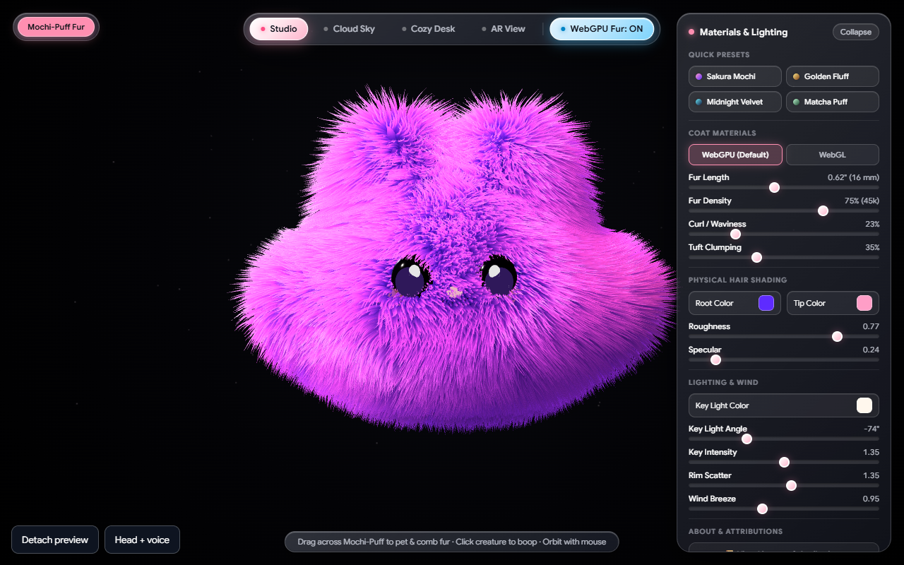
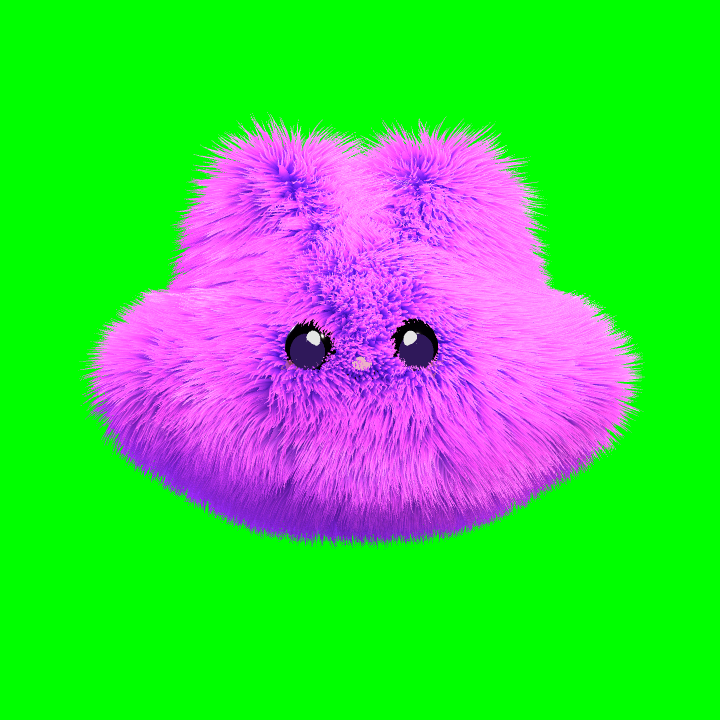

# 3D GPU Fur Simulation + Fluff Avatar

Real-time fur in the browser (WebGL2, Three.js), a streaming avatar built on it, and a Godot 4 port of the fur for games. By [Round Up Studio](https://roundup.studio).

**Try it:** https://fluff-avatar.pages.dev

| The fur demo, fully adjustable | Detached preview (what OBS captures) |
|---|---|
|  |  |

## Streaming: detached preview + head and voice

Bottom-left of the demo:

- **Detach preview** opens a window with only Mochi-Puff on a key colour (click it to cycle green, blue and magenta). It mirrors every setting from the demo's panel live: coat, colours, lighting and wind. In OBS, add a **Window Capture** of that window plus a **Chroma Key** filter. Your stream gets the creature without the settings UI.
- **Head + voice**: Mochi-Puff follows your head (camera) and opens its mouth when you speak (microphone). A notice explains both before the browser asks.

**Privacy:**
- The camera and microphone are processed only on your device, in the browser tab. Head tracking is [MediaPipe Face Landmarker](https://ai.google.dev/edge/mediapipe/solutions/vision/face_landmarker); the microphone only measures loudness.
- Nothing is recorded, stored or uploaded.
- Head angles, mouth openness and settings pass to the preview window through `BroadcastChannel` inside the same browser.
- No server.

## Fur demo

`index.html` is the interactive demo: 64 volumetric shells and 60,000 instanced strands, GPGPU spring physics, and Marschner / Kajiya-Kay hair shading, across studio, nature and AR scenes. `grass.html` is a 100k-blade grass painter on the same techniques.

## Godot port

[`godot/`](godot/) holds `FurCoat.gd` and `fur_shell.gdshader`. They put this shell fur on **any rigged or static mesh** in Godot 4 (Compatibility renderer, so it works on WebGL and mobile). Fur direction follows the skeleton, fur is shorter on thin parts, eyes and noses stay bald, and it fades at a distance. They are used for the animals in [Sector](https://roundup.studio). See [`godot/README.md`](godot/README.md).

## Run locally

```bash
npm install
npm run dev        # http://localhost:3000
npm run build      # static site in dist/
```

The camera needs `localhost` or HTTPS.

## Licence

MIT, see [LICENSE](LICENSE). Third-party notices (Three.js, React, Vite, MediaPipe, and the research the shading is based on) are in [LICENSES.md](LICENSES.md).
