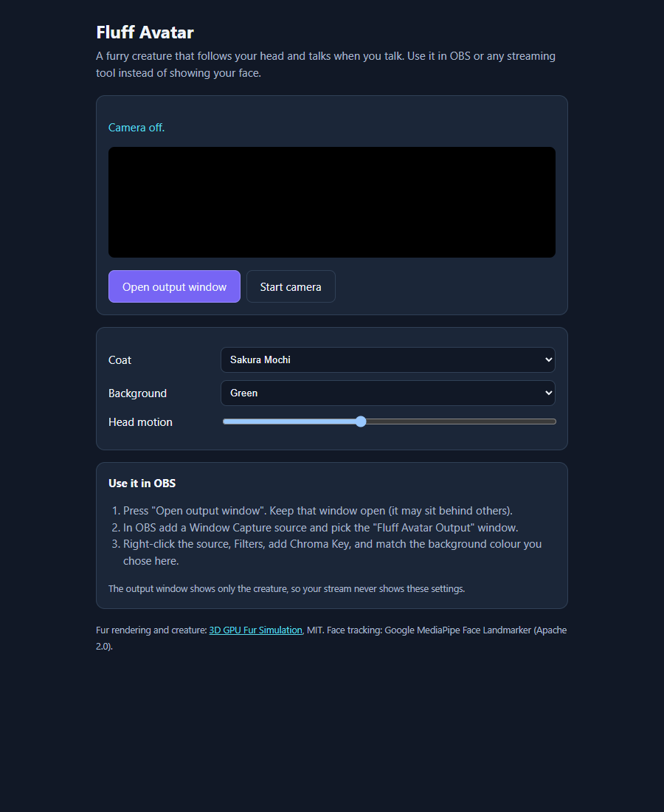

# 3D GPU Fur Simulation + Fluff Avatar

Real-time fur in the browser (WebGL2, Three.js), a streaming avatar built on it, and a Godot 4 port of the fur for games. By [Round Up Studio](https://roundup.studio).

**Try the avatar:** https://fluff-avatar.pages.dev

| Control page | Output window (what OBS captures) |
|---|---|
|  |  |

## Fluff Avatar

A furry creature that follows your head and opens its mouth when you talk. Put it in OBS or any streaming tool instead of your face.

1. Open the page and press **Start camera**. A notice explains what happens before your browser asks for the camera.
2. Press **Open output window**. That window shows only the creature, on a solid green, blue or magenta background.
3. In OBS, add a **Window Capture** of "Fluff Avatar Output", then a **Chroma Key** filter in the same colour.

Pick the coat, the background colour and how strongly it follows your head on the control page. Changes reach the output window live.

**Privacy:**
- Face tracking ([MediaPipe Face Landmarker](https://ai.google.dev/edge/mediapipe/solutions/vision/face_landmarker)) runs on your device, in the browser tab.
- The video is never recorded, stored or uploaded.
- Only head angles and mouth openness pass to the output window, through `BroadcastChannel` inside the same browser.
- No microphone, no server.

## Fur demo

`index.html` is the original interactive demo: 64 volumetric shells and 60,000 instanced strands, GPGPU spring physics, and Marschner / Kajiya-Kay hair shading, across studio, nature and AR scenes. `grass.html` is a 100k-blade grass painter on the same techniques.

## Godot port

[`godot/`](godot/) holds `FurCoat.gd` and `fur_shell.gdshader`. They put this shell fur on **any rigged or static mesh** in Godot 4 (Compatibility renderer, so it works on WebGL and mobile). Fur direction follows the skeleton, fur is shorter on thin parts, eyes and noses stay bald, and it fades at a distance. They are used for the animals in [Sector](https://roundup.studio). See [`godot/README.md`](godot/README.md).

## Run locally

```bash
npm install
npm run dev        # http://localhost:3000, avatar at /avatar.html
npm run build      # static site in dist/
```

The camera needs `localhost` or HTTPS.

## Licence

MIT, see [LICENSE](LICENSE). Third-party notices (Three.js, React, Vite, MediaPipe, and the research the shading is based on) are in [LICENSES.md](LICENSES.md).
